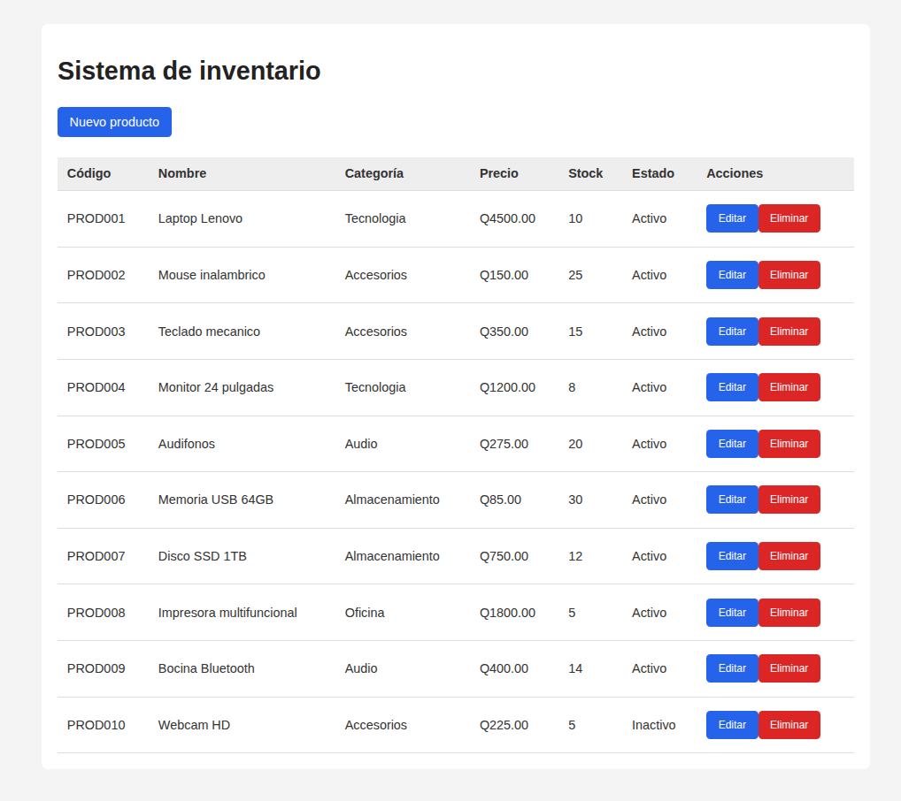
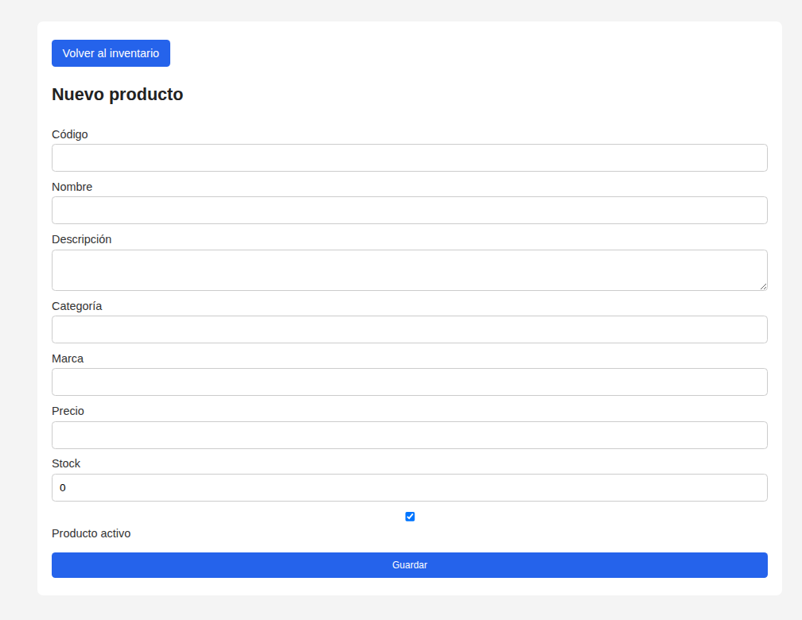
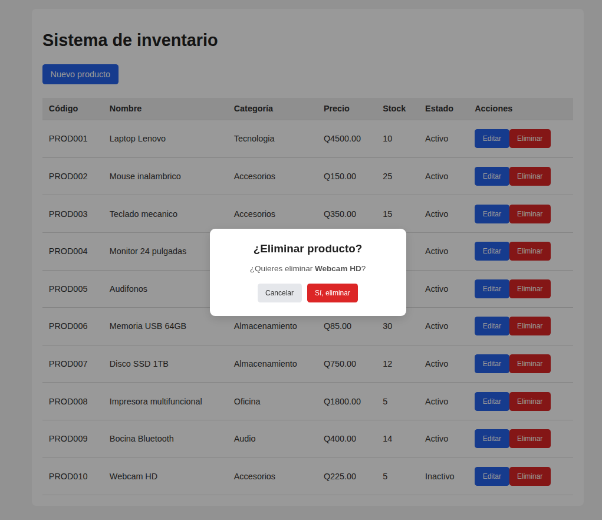
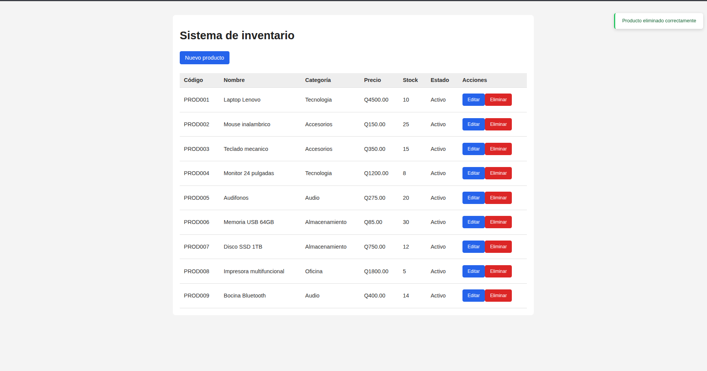

# Proyecto-de-inventario

Sistema de inventario para una pequeña tienda que permite registrar, consultar, editar y eliminar productos.

**Tecnologías utilizadas:**
PostgreSQL, Node.js, Express 5, `pg`, Zod, React, Vite, Axios, React Router.

## Requisitos

- Node.js 20 o superior
- PostgreSQL 14 o superior
- npm

# Instalación de las dependencias

**backend/:**

```bash
npm init -y
npm install express
npm install zod
npm install pg dotenv
```

**frontend/:**

```bash
npm install axios
npm install react-router
```

# Crear la base de datos

En DBeaver CE, crea una nueva conexión y ponle el nombre `inventario`, pero ya tienes que tener una base de datos local para poder crear la que necesitamos.

`schema.sql` crea la tabla `productos` y `seed.sql` inserta 10 productos de prueba.

# Variables de entorno y cómo configurarlas

| Variable | Descripción | Ejemplo |
|---|---|---|
| `VITE_API_URL` | URL base de la API | `http://localhost:9000/api/productos` |

La aplicación queda en [http://localhost:5173](http://localhost:5173). Si cambias el `.env`, reinicia `npm run dev`.

# Comandos para iniciar el backend y sus direcciones locales

**backend/:** Para iniciar, primero hay que dirigirnos a `backend` con `cd Backend` y después ejecutar `npm run dev`. Dirección local: `proyecto-de-inventario/Backend`.

**frontend/:** Para iniciar, primero hay que dirigirnos a `frontend` con `cd frontend` y después ejecutar `npm run dev`. Dirección local: `proyecto-de-inventario/frontend`.

# En el archivo .env

```env
PORT=9000
DB_HOST=localhost
DB_PORT=5432
DB_PASSWORD=tu contraseña
DB_USER=el nombre de usuario que pusiste
DB_NAME= nombre de la base de datos que reamos 
```

## Pruebas

En Postman puedes probar si todas las rutas funcionan.

**GET** | [http://localhost:9000/api/productos](http://localhost:9000/api/productos) — Ver todos los productos.

**POST** | [http://localhost:9000/api/productos](http://localhost:9000/api


## Capturas de pantalla




